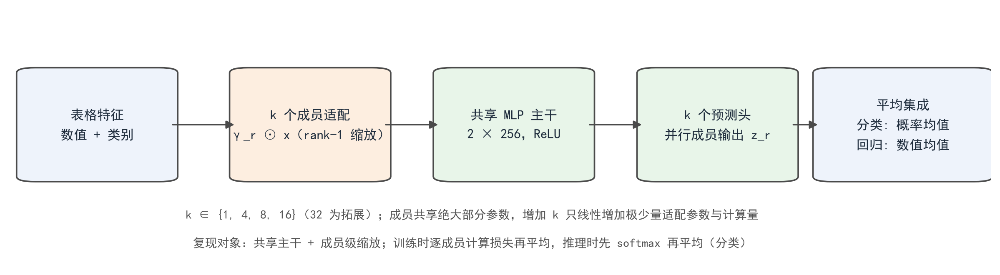

# TabM 课程规模复现（ICLR 2025 · Project 5）

**一句话简介**：在纯 CPU、三数据集、统一超参与 5 种子的课程预算下，独立复现 TabM（参数高效集成）的机制与相对趋势，并用裁剪消融、成本测量、误差分析与 k 个独立 MLP 的成本上界，检验它的三条研究假设是否仍然成立。

> 主论文：Gorishniy Y. et al. *TabM: Advancing Tabular Deep Learning with Parameter-Efficient Ensembling*, ICLR 2025
> 仓库：<https://github.com/May712-hzx/Tabm> ｜ 课程报告（18 页 = 封面 1 + 正文 17）：作为课程提交材料单独提交，**按课程要求不入库**，可用 `python paper/build_report.py` 本地生成

## 1 项目名称与简介

| 项 | 内容 |
|---|---|
| 项目名称 | TabM 复现：参数高效集成在表格数据上的收益与成本 |
| 课程任务 | 《深度学习》期末项目 · Project 5（复现 ICLR 2025 论文） |
| 复现对象 | 官方 pip 包 `tabm` 的 TabM 结构 + 自写训练 / 评估循环（不使用原仓库的重型配置系统） |
| 规模 | 3 数据集 × 5 种子 × k∈{1,4,8,16} × 4 模型族 = 165 次主训练，加 15 组裁剪推理、12 组独立 MLP 对照 |
| 硬件 | 单台 Windows PC，纯 CPU，无 GPU |

## 2 问题定义、适用场景与主要功能

**问题定义**：TabM 的核心主张是「用共享主干 + 成员级 rank-1 缩放，在几乎不增加参数的前提下拿到 k 个成员的集成收益」。但该结论建立在 GPU、46 个数据集与逐数据集调参之上。在算力受限、统一超参、3 个中等规模数据集的课程条件下，这条结论是否仍成立、代价是否仍值得，缺少独立证据。

**适用场景**：中低维表格数据的分类 / 回归（样本 1e4~1e5、特征数十维），部署侧对**存储或显存敏感**而训练侧算力可接受（无 GPU、可容忍较长训练时间）的场景。

**主要功能**：

1. 统一数据管线：固定 train/val/test 划分、预处理只 fit 训练集、OOV 类别回退、三数据集加载含回退逻辑；
2. 训练 / 评估框架：MLP、XGBoost、HistGBM、TabM(k=1/4/8/16)，输出主指标、LogLoss、AUC、ECE、参数量、训练时间；
3. 三类分析与一项拓展：H3 成员裁剪消融、效率测量（推理延迟 / 峰值内存 / 成本放大）、误差与失败分析（混淆矩阵、按类召回、高置信错分）、k 个独立 MLP 的严格成本对照；
4. 工程质量：21 项单元测试、自动实验记录表（`results/experiments_log.md`）、自动运行日志（`results/logs/`）、配置快照（`configs/default.json`）。

## 3 方法概述与架构图

成员 `r` 携带一个 rank-1 缩放向量 `γ_r`，先把输入按成员缩放，再送入**共享**主干，一次前向并行得到 k 个预测：

```
x'_r = γ_r ⊙ x      z_r = f_θ(x'_r)      f_θ = 2 × 256, ReLU, dropout 0.1
训练  L(θ,γ) = 1/(n·k) Σ_i Σ_r ℓ(f_θ(γ_r ⊙ x_i), y_i)      # 逐成员算损失再平均
推理  p̄ = 1/k Σ_r softmax(z_r)（分类）  /  ŷ = 1/k Σ_r z_r（回归）
```



三条口径被单元测试锁定：**逐成员损失**（不是先平均预测再算损失）、**先 softmax 再平均**、**预处理只在训练集 fit**。

结构细节、与 BatchEnsemble / 独立 MLP 的差异、H3 裁剪做法与全部超参见 [docs/method.md](docs/method.md)。

## 4 环境要求与安装

| 项 | 要求 |
|---|---|
| Python | 3.13（其他 3.10+ 亦可） |
| 依赖 | `torch`(CPU 版)、`numpy`、`pandas`、`scikit-learn`、`xgboost`、`openml`、`psutil`、`tabm`（官方 pip 包） |
| 报告生成（可选） | `python-docx`、`matplotlib` |
| 硬件 | 无 GPU 要求；主实验在 8~16 GB 内存的普通 PC 上可跑完 |

```bash
git clone https://github.com/May712-hzx/Tabm.git && cd Tabm

# 精确复现本机环境（推荐）
pip install -r requirements.lock
# 或宽松安装
pip install -r requirements.txt
```

> 若 PATH 里第一个 `python` 不是本项目使用的运行时，请显式调用完整路径。本项目实测解释器为 `D:\python3.13\python.exe`。

## 5 数据获取与目录放置

三个数据集都由代码**自动下载并缓存**，仓库不含数据文件，无需手工放置。

| 数据集 | 任务 | 来源 | 规模（本项目使用） | 特征 |
|---|---|---|---|---|
| Adult | 二分类（收入 >50K） | OpenML id=1590 | 48,842 行（全量） | 6 数值 + 8 类别 |
| Covertype | 7 类多分类 | `sklearn.datasets.fetch_covtype` | 下采样 **50,000** 行（全量 581,012） | 54 数值 |
| California Housing | 回归（房价中位数） | sklearn 缓存 / OpenML id=44977 重建 | 20,640 行 | 8 数值 |

- 缓存位置：sklearn 数据集落在 `~/scikit_learn_data/`，OpenML 落在 `~/.cache/openml`；离线环境可预先把缓存目录整体拷入。
- **California 三级回退**：① 本地 `cal_housing.pkz` 存在 → 直接用 sklearn；② 否则从 OpenML 44977 重建（`AveRooms=totalRooms/households`、`AveBedrms=totalBedrooms/households`、`AveOccup=population/households`、`target=medianHouseValue/1e5`）；③ 原 figshare 地址在本机返回 HTTP 403，故不作为首选。
- 划分：先 8:2 切测试集，再从剩余按 8:2 切验证集（≈64/16/20）；分类两次都分层，回归不分层。

## 6 最小可运行示例

只想确认代码能跑通，用最省时的单数据集配置：

```bash
# 1) 先跑测试（约 5 s，不训练）
python -m unittest discover -s tests -v

# 2) 只跑 Adult + 单种子：编辑 src/config.py
#    DATASETS = ["adult"]；SEEDS = [0]
python scripts/run_exp.py

# 3) 查看结果（11 行：4 模型族 + k=1/4/8/16 + 树模型）
python -c "import pandas as pd; print(pd.read_csv('results/all_result.csv').tail(11).to_string())"
```

预期输出：`results/all_result.csv` 末尾追加 11 行（Adult、seed 0），其中 TabM k=1/4/8/16 的 Macro-F1 约在 0.78~0.80，训练时间随 k 从十几秒增长到一分钟量级；同时 `results/logs/run_exp_<时间戳>.log` 自动生成，记录本次命令与全部输出。

## 7 训练、评估、演示命令

完整产物、依赖顺序与耗时见 [docs/reproduce.md](docs/reproduce.md)。

| 命令 | 做什么 | 主要产物 |
|---|---|---|
| `python scripts/run_exp.py` | 主实验矩阵（165 次训练） | `results/all_result.csv`、`ckpt/*.pt` |
| `python scripts/backfill_experiment_log.py` | 把历史结果补进实验记录表 | `results/experiments_log.md` |
| `python scripts/run_crop_ablation.py` | H3 裁剪消融（加载 k=16 权重，纯推理） | `results/all_result.csv`（追加行） |
| `python scripts/eval_extra_auc.py --fill` | 补 covertype 的 macro-OvR AUC | `results/extra_metrics/` |
| `python scripts/fill_crop_auc.py --fill` | 补裁剪行的 AUC（纯推理） | `results/all_result.csv`（回填） |
| `python scripts/eval_cost.py` | 推理延迟、权重内存、RSS 增量 | `results/cost/infer_cost.csv` |
| `python scripts/eval_cost.py --train-peak` | 训练峰值内存（每配置独立子进程） | `results/cost/train_peak_seed0.csv` |
| `python scripts/error_analysis.py` | 混淆矩阵、按类指标、高置信错分样本 | `results/error_analysis/`、`plots/error_analysis/` |
| `python scripts/eval_member_variance.py` | 逐样本概率方差、argmax 分歧率 | `results/variance/member_variance.csv` |
| `python plots/plot_result.py` | 主实验四联图（主指标 / LogLoss / 时间 / ECE） | `plots/<ds>_tabm_k_ablation.png` |
| `python plots/plot_h3_crop.py` | H3 三合一图 | `plots/<ds>_h3_crop_ablation.png` |
| `python extension/run_indep_mlp.py` | k 个独立 MLP（成本上界，独立板块） | `results/extension/` |
| `python extension/compare_with_tabm.py` | TabM vs 独立 MLP 逐 k 对照 | `results/extension/cost_comparison.csv` |
| `python extension/plot_indep_mlp.py` | 性能 / 参数 / 时间 / 参数-性能 四联图 | `plots/extension/<ds>_indep_mlp_vs_tabm.png` |
| `python paper/build_report.py` | 由结果文件生成课程报告（以学校封面模板为底稿） | 本地生成 `paper/黄思桦 202425310307.docx` 与同名 PDF（报告不入库） |

每次运行都会自动留下 `results/logs/<脚本>_<时间戳>.log` 与 `results/experiments_log.md` 中对应的一行记录。

## 8 测试与代码检查命令

```bash
python -m unittest discover -s tests -v      # 21 项，全部通过（约 5 s）
```

| 测试文件 | 覆盖内容 |
|---|---|
| `tests/test_dataset.py` | 三个数据集划分互不重叠、比例正确；预处理只在训练集 fit（测试集统计量不泄漏）；同 seed 可复现；类别编码 `0 <= id < cardinality` |
| `tests/test_models.py` | TabM 输出 `(B, k, d_out)`、MLP 输出 `(B, d_out)`；TabM 参数量远小于 k × 独立 MLP；k=1 与 MLP 结构等价性 |
| `tests/test_loss_and_metrics.py` | 逐成员损失 vs 先平均预测再算损失的**数值与梯度都不相同**；先 softmax 再平均的聚合口径；Macro-F1 / AUC / LogLoss 与 sklearn 一致；ECE 在已知分布上的取值 |

> 代码风格检查未接入 linter；本项目以单元测试 + 实跑结果一致性（报告数字逐项回对 `results/`）作为验收口径。

## 9 主要结果与指标口径

三个数据集的最优 TabM 档与关键对照（5 种子 mean；完整表见 [docs/results.md](docs/results.md)）：

| 数据集 | 主指标 | 最强树模型 | MLP | TabM 最优 | 结论 |
|---|---|---|---|---|---|
| Adult | Macro-F1 | HistGBM 0.8140 | 0.7861 | 0.7943（k=8） | TabM 高于 MLP +0.8 pp，仍落后树模型 −2.0 pp |
| California | R² | HistGBM 0.8329 | 0.8008 | 0.8088（k=4） | TabM 高于 MLP +0.008 R²，落后树模型 −0.024 |
| Covertype | Macro-F1 | XGBoost 0.7597 | 0.7784 | 0.7929（k=4） | TabM 小幅领先所有对照；但 k=16 掉到 0.7631 |

| 指标 | 定义与口径 |
|---|---|
| Macro-F1 | 各类 F1 的算术平均（分类主指标）；Adult 2 类、Covertype 7 类 |
| ROC-AUC | 多分类按 one-vs-rest 计算各类 AUC 后取平均；二分类为常规 AUC；回归任务无定义 |
| LogLoss | 测试集平均交叉熵，越小越好 |
| ECE | 期望校准误差，10 个等宽分箱，越小越好 |
| R² / RMSE | 回归主指标与误差（California 目标已缩放回原始量纲） |
| 参数量 | 可训练参数总数（TabM 含 k 组缩放向量；树模型不计） |
| 训练时间 | 单次完整训练耗时；受同机并行任务影响，涉及倍数的讨论统一用中位数口径 |
| 推理延迟 | batch=256 的模型前向毫秒/样本，不含 DataLoader |
| 峰值内存 | 训练子进程 RSS 峰值（MB），含进程基线（import torch + 加载数据约 350~410 MB） |

**四条主结论**：H1 方向成立但强度不足（提升幅度与种子噪声同量级）；H2 证据不足偏否（成员相关性 0.86~0.99，但独立 MLP 对照说明机制有效、TabM 未充分利用）；H3 不支持（6 组中 5 组裁剪更差）；「参数高效」成立而「计算高效」不成立（参数 ×1.30~1.57、训练时间 ×8~14）。

## 10 目录结构

```plaintext
project_tabm/
├─ README.md                 # 本文件：12 项必备结构
├─ requirements.txt / .lock  # 宽松依赖 / 本机实测环境精确版本
├─ configs/                  # 运行配置快照（default.json + dump_config.py）
├─ docs/                     # 长期内容：method / results / reproduce
├─ src/                      # config / dataset / models / trainer / utils / run_log
├─ scripts/                  # run_exp、H3 裁剪、AUC 补算、成本、误差分析、记录回填
├─ extension/                # 独立板块：k 个独立 MLP 成本对照（不污染主实验）
├─ tests/                    # 21 项单元测试
├─ ckpt/                     # 仅 k=16 的 TabM 权重（15 个）
├─ results/                  # 原始结果 csv、实验记录表、运行日志、误差/成本/方差产物
├─ plots/                    # 主图、H3 图、误差图、拓展图
├─ paper/                    # 报告生成脚本、封面模板与结构图（报告 docx/pdf 不入库）
└─ legacy/                   # 旧版代码与权重，隔离存档，新代码不读取
```

## 11 团队分工与贡献说明

本项目为**个人独立完成**，无组内分工。各环节的实际贡献：

| 环节 | 内容 |
|---|---|
| 代码与实验 | 数据管线、训练循环、裁剪消融、效率测量、误差分析、拓展板块的脚本编写与调试；全部 165 次主训练、15 组裁剪推理、12 组独立 MLP 对照的实机运行 |
| 数据分析 | 主表、效率表、裁剪表、误差表的统计与配对检验；异常值识别与口径修正（如 covertype 训练时间污染改用中位数） |
| 报告写作 | 结构设计、全部正文撰写、14 张表与 6 张图的制作 |
| 质量核查 | 21 项单元测试；报告数字与 `results/` 原始文件逐项回对；README 复现流程自测 |

生成式 AI 使用情况见课程报告附录 D（报告不入库，用 `paper/build_report.py` 本地生成）：仅用于代码调试辅助、脚本样板与文字润色；全部实验数据由本人在本机实际运行产生，AI 未生成或修改任何实验结果，文字与代码均逐段核对。

## 12 已知限制、许可证、数据与第三方代码来源

**已知限制**

1. **算力缩减**：纯 CPU、Covertype 下采样至 5 万行（约全量 8.6%）、统一 100 epoch 预算且无超参搜索，故绝对数值不可与论文表格直接比较，只能比较同预算下的相对趋势；
2. **仍缺的三项**：常数预测基线（多数类 / 均值）、逐 epoch 训练曲线、`all_result.csv` 的 raw/summary 拆分；
3. **口径残余风险**：训练时间受同机并行任务影响（已改用中位数并剔除污染运行）；推理延迟只测模型前向，不等同端到端服务延迟；k 只扫到 16，裁剪只做「16 → 4/8」两个尺寸；
4. **数据层面**：Adult 含性别、种族、原国籍等敏感属性；Covertype 类别不均衡；California 房价标签含地理与历史歧视痕迹——三者只作方法学实验，不能作为现实决策依据。

**许可证**

- 本仓库自写代码（`src/`、`scripts/`、`tests/`、`extension/`、`plots/`、`paper/`）采用 MIT 许可证，见 [`LICENSE`](LICENSE)。
- 第三方组件均通过 pip 安装、未复制其源码，遵循各自上游许可证（torch、scikit-learn、xgboost、openml、tabm 等）。
- 数据集为公开数据（UCI / OpenML / sklearn 内置），按各自原始许可使用，仓库不分发数据文件。

**数据来源**

| 数据 | 来源 | 说明 |
|---|---|---|
| Adult | UCI Machine Learning Repository / OpenML id=1590 | 公开，`<=50K`→0、`>50K`→1 |
| Covertype | UCI / `sklearn.datasets.fetch_covtype` | 公开，`target−1` 转 7 类，下采样 5 万行 |
| California Housing | StatLib（Pace & Barry 1997）/ sklearn 或 OpenML 44977 | 公开，按 sklearn 口径重建 |

**第三方代码来源**

| 组件 | 用途 | 获取方式 |
|---|---|---|
| `tabm`（官方 pip 包） | TabM 模型结构，本项目仅调用其 `TabM` 类，训练循环自写 | `pip install tabm` |
| PyTorch / numpy / pandas / scikit-learn / xgboost / openml / psutil | 训练、预处理、指标、数据获取、内存采样 | `pip install -r requirements.lock` |
| `paper/build_report.py` 使用的 `python-docx`、`matplotlib` | 报告文档与结构图生成 | `pip install python-docx matplotlib` |
