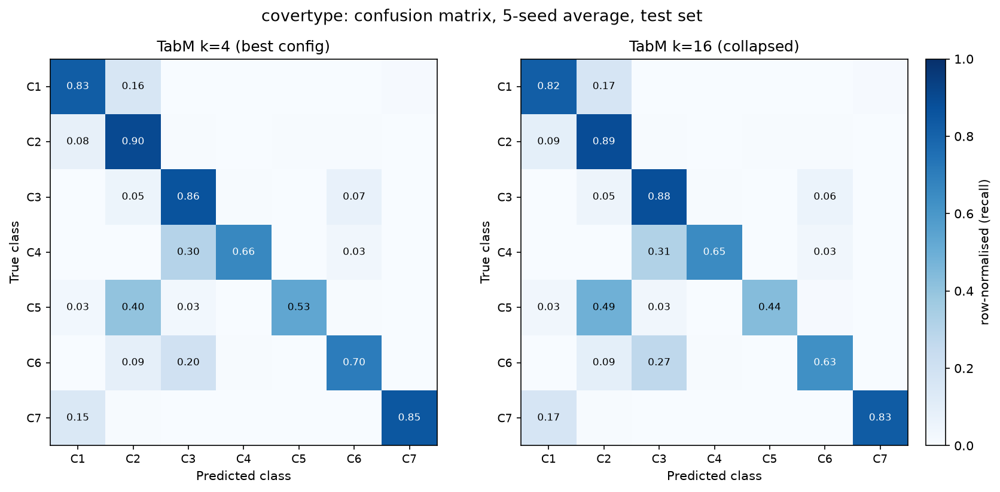

# TabM 复现项目（ICLR 2025）— 深度学习课程期末项目 Project-5

> 论文：**TabM: Advancing Tabular Deep Learning with Parameter-Efficient Ensembling**
> 实现：官方 pip 包 `tabm` + 自写训练 / 评估循环（不使用原仓库的重型配置系统）
> 课程规模复现：3 数据集 · 5 种子 · k∈{1,4,8,16} · CPU 训练

---

## 0 一页结论

| 假设 | 判定 | 证据 |
|---|---|---|
| **H1** TabM(k>1) 优于同预算 MLP | **部分支持** | 三个数据集上 TabM(k≥4) 均高于 MLP：adult +0.4~0.6pp、california +0.3~0.8pp、covertype +0.4~1.5pp；但幅度全部小于种子标准差量级（±0.4~2.2pp），只有 adult 的 k=16 vs k=1 达到配对 t 检验显著（p=0.011） |
| **H2** 收益来自成员多样性而非单纯加参数 | **证据不足（偏否）** | 参数量只涨 1.30~1.57 倍，训练时间却涨 8~14 倍；成员相关性 `member_corr` 始终 0.86~0.99，逐样本概率方差 TabM 只有独立 MLP 的 40%（adult）/ 76%（covertype），说明成员输出高度趋同、多样性很弱；且 covertype 上 k=16 显著劣于 k=1 |
| **H3** 大 k 训练后裁剪可能优于直接训练小 k | **不支持** | 6 组对照里 5 组裁剪劣于原生同 k，仅 adult crop=4 择优裁剪略优（+0.24pp，落在种子噪声内）；covertype 裁剪掉 3~4pp，从 0.793 跌到 0.754（随机裁剪）。同时**校准与区分度双降**：ECE 从 0.015 恶化到 0.032、macro-OvR AUC 从 0.9822 掉到 0.9784~0.9792 |
| **拓展** 与 k 个独立 MLP 的严格成本对照 | **参数高效成立，泛化性有限** | adult/california 上 TabM 与独立 k×MLP 性能打平（Δ≤0.005）却只用 1/4~1/13 参数、1/1.5~1/2.9 时间；但 covertype 上 k=16 独立 MLP 反超 TabM **3.6pp**（见 §6.5） |

**总体判断**：在本课程规模下（CPU、covertype 下采样 5 万行、固定 100 epoch 预算），TabM 相对 MLP 的优势存在但很小，**远不足以抵消其 8~14 倍的训练成本**，且明显落后于 XGBoost / HistGBM（adult −2.0pp、california −0.024 R²、covertype 上 TabM 反而小幅领先树模型）。这一结论与论文在完整预算下的结论方向不一致，报告必须把预算差异写清楚（见 §7）。

---

## 1 环境安装

```bash
pip install -r requirements.txt
```

已验证环境（本机实测）：

| 项 | 值 |
|---|---|
| Python | 3.13（`D:\python3.13\python.exe`） |
| torch | 2.15.0+cpu |
| numpy | 2.5.1 |
| scikit-learn | 1.x |
| xgboost | 2.x |
| GPU | 无（纯 CPU） |

> 注意：若 PATH 里第一个 `python` 是别的运行时（无 numpy），请显式用完整路径调用。

---

## 2 数据集

| 数据集 | 任务 | 来源 | 规模 |
|---|---|---|---|
| Adult | 二分类 | OpenML id=1590 | 48842 行，6 数值 + 8 类别 |
| Covertype | 7 类多分类 | `sklearn.datasets.fetch_covtype`（首次联网，之后走本地缓存） | 581012 行，**默认下采样 50000** |
| California Housing | 回归 | sklearn 本地缓存优先，否则 OpenML id=44977 重建 | 20640 行，8 个数值特征 |

**California 的三级回退**（`fetch_california_housing` 依赖 figshare，该地址在本机返回 `HTTP 403`）：

1. `~/scikit_learn_data/california_housing/cal_housing.pkz` 存在 → 直接用 sklearn；
2. 否则从 **OpenML id=44977** 拉原始表，按 sklearn 口径重建：
   `MedInc=medianIncome`、`HouseAge=housingMedianAge`、`AveRooms=totalRooms/households`、
   `AveBedrms=totalBedrooms/households`、`Population`、`AveOccup=population/households`、
   `Latitude`、`Longitude`，`target = medianHouseValue / 100000`（恢复到 sklearn 的 0.15~5.0 量纲）。

---

## 3 复现命令与产物对照

**所有命令在项目根目录 `D:\project_tabm` 下执行。**

| # | 命令 | 产物文件 | 内容 |
|---|---|---|---|
| 0 | `python -m unittest discover -s tests -v` | 控制台输出 | 21 项测试：数据划分无重叠、预处理只 fit 训练集、TabM/MLP 输出形状、逐成员损失梯度、指标与 sklearn 一致 |
| 1 | `python scripts/run_exp.py` | `results/all_result.csv` | 主实验全部行（165 行 = 3 数据集 × 5 种子 × 11 配置） |
| 1 | 同上 | `ckpt/tabm_<ds>_seed<s>_k16.pt` | 仅 k=16 的 TabM 权重（15 个 = 3 数据集 × 5 种子） |
| 1 | 同上 | `results/experiments_log.md` | **实验记录表**，每写一行结果自动追加一条（无需手工维护） |
| 2 | `python scripts/run_crop_ablation.py` | `results/all_result.csv`（追加） | `tabm_crop_random` / `tabm_crop_valbest` 行，每个 crop size 5 种子 |
| 3 | `python plots/plot_result.py` | `plots/<ds>_tabm_k_ablation.png` | 主实验 2×2：主指标 / 损失 / 训练时间 / ECE 随 k |
| 4 | `python plots/plot_h3_crop.py` | `plots/<ds>_h3_crop_ablation.png` | H3 三合一：主指标 / ECE / 成员相关性 |
| 5 | `python scripts/error_analysis.py` | `results/error_analysis/` 下 7 个文件<br>`plots/error_analysis/covertype_confusion_k4_vs_k16.png` | 错误/失败分析：按类 P/R/F1、混淆矩阵（k4 vs k16）、高置信度错分样本、`summary.txt` |
| 6 | `python scripts/eval_extra_auc.py --fill` | `results/extra_metrics/covertype_auc.csv`<br>`results/all_result.csv`（回填 roc_auc） | 补算 covertype 的 macro-OvR AUC（k=16 走 ckpt，其余重训，约 60 min） |
| 6b | `python scripts/fill_crop_auc.py --fill` | `results/all_result.csv`（回填裁剪行 roc_auc） | 补 `tabm_crop_random` / `tabm_crop_valbest` 行的 AUC：只加载 ckpt 推理、按同一成员选择口径复现，**不训练**（约 45 s） |
| 6c | `python scripts/eval_cost.py` | `results/cost/infer_cost.csv` | 推理时间（ms/sample，模型前向延迟）+ 理论权重内存 `model_mb` + RSS 增量，105 行 = 3 数据集 × 5 种子 × 7 配置（约 2.5 min） |
| 6d | `python scripts/eval_cost.py --train-peak` | `results/cost/train_peak_seed0.csv` | 训练峰值 RSS：**每个配置单独子进程**测量（21 行 = 3 数据集 × 7 配置，seed=0） |
| 6e | `python scripts/eval_member_variance.py` | `results/variance/member_variance.csv` | 逐样本概率方差 / argmax 分歧率 / 成员相关性，TabM k=16 vs 独立 16×MLP，30 行（约 20 s） |
| 7 | `python scripts/backfill_experiment_log.py` | `results/experiments_log.md` | 把已有的 `all_result.csv` 历史行批量补进实验记录表（幂等，可重复执行） |
| 8 | `python extension/run_indep_mlp.py` | `results/extension/indep_mlp_result.csv`<br>`results/extension/member_probs_<ds>_seed<s>.npz` | k 个独立 MLP 集成（成本上界）+ 逐成员预测 |
| 9 | `python extension/compare_with_tabm.py` | `results/extension/cost_comparison.csv` | TabM 与独立 MLP 的逐 k 成本/性能对照 |
| 10 | `python extension/plot_indep_mlp.py` | `plots/extension/<ds>_indep_mlp_vs_tabm.png` | 性能/参数/时间/参数-性能散点 四联图 |

**自动运行日志（只要跑就有记录）**：每个脚本入口都包了 `src/run_log.py` 的 `run_log()`，
无论正常结束还是中途报错退出，都会自动生成 `results/logs/<脚本名>_<时间戳>.log`，
内含开始/结束时间、完整命令行、工作目录、Python 与依赖版本、全部 stdout/stderr、异常 traceback、耗时与状态；
同时在 `results/logs/index.md` 追加一行索引（脚本 / 命令 / 耗时 / 状态 / 日志文件名）。

> 两个「记录」的分工，别混淆：
> - `results/experiments_log.md` = **一次实验配置一行**（数据集 / seed / 模型 / k → 指标），由 `save_result()` 写 csv 时自动追加；
> - `results/logs/<脚本名>_<时间戳>.log` = **一次脚本运行一份**（过程、输出、报错），由 `run_log()` 启动时自动生成。
>
> `extension/run_log.txt` 是 `extension/run_indep_mlp.py` 早期自己重定向 stdout 写的运行记录，
> **不是实验记录表**；接入 `run_log()` 后其作用已被 `results/logs/ext_run_indep_mlp_*.log` 取代，保留仅作历史。

**依赖顺序**：2 依赖 1 的 ckpt；4 依赖 2；5 独立（k=16 走 ckpt）；6 依赖 1 的 ckpt；6b 依赖 1 的 ckpt + 2 的裁剪行；6c 依赖 1 的 ckpt（k=16 直接加载，其余用同结构未训练模型，只测推理）；6d 独立重训；6e 依赖 1 的 ckpt + 8 的 npz；7 必须在 1/2 之后；9 依赖 1 和 8；10 依赖 8。

**一键复现（按序执行）**：

```bash
python -m unittest discover -s tests -v      # 0. 先验证代码正确性（约 5 s）
python scripts/run_exp.py                    # 1. 主实验（约 3 h）
python scripts/backfill_experiment_log.py    # 7. 生成实验记录表
python scripts/run_crop_ablation.py          # 2. H3 裁剪（约 5 min）
python scripts/eval_extra_auc.py --fill      # 6. 补 covertype AUC（约 1 h，支持断点续跑）
python scripts/fill_crop_auc.py --fill       # 6b. 补 H3 裁剪行 AUC（约 45 s，纯推理）
python scripts/eval_cost.py                  # 6c. 推理时间与权重内存（约 2.5 min）
python scripts/eval_cost.py --train-peak     # 6d. 训练峰值 RSS（约 25~40 min，每配置独立进程）
python scripts/error_analysis.py             # 5. 错误分析（约 20 min）
python plots/plot_result.py                  # 3.
python plots/plot_h3_crop.py                 # 4.
python extension/run_indep_mlp.py            # 8. 拓展板块（约 2.5 h）
python scripts/eval_member_variance.py       # 6e. 逐样本概率方差（约 20 s，依赖 8 的 npz）
python extension/compare_with_tabm.py        # 9.
python extension/plot_indep_mlp.py           # 10.
```

**清空重跑**（只删产物，不动代码）：删 `results/all_result.csv`、`results/experiments_log.md`（连同 `.keys`）、`results/extension/`、`results/error_analysis/`、`results/extra_metrics/`、`results/cost/`、`results/variance/`、`ckpt/*.pt`、`plots/*.png`、`plots/extension/*.png`、`plots/error_analysis/*.png`。

**预估耗时（本机纯 CPU）**：步骤 1 约 3 小时，步骤 2 约 5 分钟（纯推理），步骤 5 约 20 分钟（k=4 需重训 5 种子），步骤 6 约 1 小时，步骤 6c 约 2.5 分钟，步骤 6d 约 52 分钟（21 个子进程），步骤 6e 约 20 秒，步骤 8 约 2.5 小时。

---

## 4 主结果

`mean ± std`，5 个随机种子，测试集仅用于最终评估。

### 4.1 Adult（二分类，主指标 Macro-F1）

| 模型 | Macro-F1 | ROC-AUC | LogLoss | ECE | 参数量 | 训练时间 |
|---|---|---|---|---|---|---|
| XGBoost | 0.8133 ± 0.0032 | 0.9267 ± 0.0017 | 0.2809 | 0.0132 | — | 0.4 s |
| HistGBM | 0.8140 ± 0.0038 | 0.9277 ± 0.0018 | 0.2783 | 0.0061 | — | 0.3 s |
| MLP | 0.7861 ± 0.0069 | 0.9099 ± 0.0032 | 0.3142 | 0.0091 | 102,488 | 12.1 s |
| TabM k=1 | 0.7888 ± 0.0042 | 0.9129 ± 0.0026 | 0.3088 | 0.0081 | 94,932 | 11.3 s |
| TabM k=4 | 0.7920 ± 0.0064 | 0.9141 ± 0.0019 | 0.3064 | 0.0070 | 100,636 | 29.1 s |
| TabM k=8 | **0.7943** ± 0.0039 | 0.9148 ± 0.0017 | 0.3055 | 0.0081 | 108,242 | 54.6 s |
| TabM k=16 | 0.7929 ± 0.0047 | 0.9149 ± 0.0017 | 0.3050 | 0.0082 | 123,453 | 121.5 s |

### 4.2 California Housing（回归，主指标 R²）

| 模型 | R² | RMSE | 参数量 | 训练时间 |
|---|---|---|---|---|
| XGBoost | 0.8293 ± 0.0036 | — | — | 0.3 s |
| HistGBM | **0.8329** ± 0.0064 | — | — | 0.2 s |
| MLP | 0.8008 ± 0.0062 | — | 68,353 | 19.3 s |
| TabM k=1 | 0.8059 ± 0.0076 | 0.5055 | 69,129 | 23.2 s |
| TabM k=4 | 0.8088 ± 0.0060 | 0.5018 | 73,764 | 60.4 s |
| TabM k=8 | 0.8050 ± 0.0104 | 0.5067 | 79,944 | 96.2 s |
| TabM k=16 | 0.8041 ± 0.0054 | 0.5079 | 92,304 | 187.3 s |

### 4.3 Covertype（7 类，下采样 5 万行，主指标 Macro-F1）

| 模型 | Macro-F1 | ROC-AUC (macro-OvR) | LogLoss | ECE | 参数量 | 训练时间 |
|---|---|---|---|---|---|---|
| XGBoost | 0.7597 ± 0.0101 | 0.9767 ± 0.0013 | 0.4052 | 0.0198 | — | 2.1 s |
| HistGBM | 0.7296 ± 0.0424 | 0.9594 ± 0.0217 | 0.4800 | 0.0275 | — | 2.0 s |
| MLP | 0.7784 ± 0.0225 | 0.9799 ± 0.0011 | 0.3813 | 0.0187 | 81,671 | 53.7 s |
| TabM k=1 | 0.7850 ± 0.0211 | 0.9804 ± 0.0031 | 0.3765 | 0.0188 | 82,493 | 60.7 s |
| TabM k=4 | **0.7929** ± 0.0146 | **0.9822** ± 0.0015 | **0.3484** | **0.0151** | 91,892 | 196.9 s |
| TabM k=8 | 0.7820 ± 0.0102 | 0.9816 ± 0.0007 | 0.3606 | 0.0264 | 104,424 | 363.9 s |
| TabM k=16 | 0.7631 ± 0.0123 | 0.9794 ± 0.0012 | 0.3825 | 0.0362 | 129,488 | 856.6 s |

> ⚠️ **covertype 训练时间的口径问题（必须标注）**：seed=4 的那一整轮与其它任务在同一台机器上并行，
> k=8 / k=16 的单次训练被拖到 754 s / 1413 s；seed=3 的 k=16 也被拖到 1394 s。
> 所以上表 k=16 的「856.6 s」是**被两个异常值抬高的均值**，不能直接引用。
> **稳健口径用中位数**：k=1 = 45.3 s、k=4 = 151.3 s、k=8 = 266.1 s、k=16 = 510.7 s。
> 参数量那一列不受运行环境影响，可以直接用。

> **AUC / LogLoss 的口径**：这两列由 `scripts/eval_extra_auc.py --fill` 单独补算——
> k=16 直接加载 `ckpt/` 权重推理，其余配置按同一划分/同一预算**重训**后取测试集概率，
> 结果落在 `results/extra_metrics/covertype_auc.csv`（35 行）并回填本表。
> 因此同一行的 AUC 与 Macro-F1 **不是同一次训练**的产物（重训有随机波动，实测 Macro-F1 偏差 ≤1pp）。
> 跨行比较 AUC 趋势是安全的，但不要把「AUC 与 F1 同行的绝对差」当作同一模型的内部关系。
> HistGBM 的 AUC 均值 0.9594 被 seed=4 的一次崩溃（0.9234，对应 Macro-F1 0.662）拉低，其余 4 个种子在 0.9567~0.9767。

### 4.4 成本放大倍数（相对同数据集 k=1）

| 数据集 | k=4 | k=8 | k=16 |
|---|---|---|---|
| adult | 参数 ×1.06 / 时间 ×2.56 | ×1.14 / ×4.81 | ×1.30 / ×10.72 |
| california | ×1.07 / ×2.60 | ×1.16 / ×4.14 | ×1.34 / ×8.06 |
| covertype（均值口径，受污染） | ×1.11 / ×3.25 | ×1.27 / ×6.00 | ×1.57 / ×14.12 |
| **covertype（中位数口径，推荐）** | ×1.11 / **×3.34** | ×1.27 / **×5.87** | ×1.57 / **×11.27** |

**关键观察**：参数近乎线性增长（1.3~1.6 倍封顶，这是 TabM 的设计目标），但**训练时间随 k 近似线性膨胀**（8~14 倍），说明"参数高效"并不等于"计算高效"。

### 4.5 推理时间与内存（指导书步骤 6）

产物：`results/cost/infer_cost.csv`（105 行 = 3 数据集 × 5 种子 × 7 配置）+ `results/cost/train_peak_seed0.csv`（21 行 = 3 数据集 × 7 配置，seed=0）。

**推理延迟**（ms/sample，5 个种子取中位）

| 配置 | adult | california | covertype |
|---|---|---|---|
| XGBoost | 0.0006 | 0.0008 | 0.0041 |
| HistGBM | 0.0016 | 0.0017 | 0.0091 |
| MLP | 0.0030 | 0.0015 | 0.0017 |
| TabM k=1 | 0.0048 | 0.0024 | 0.0031 |
| TabM k=4 | 0.0081 | 0.0050 | 0.0061 |
| TabM k=8 | 0.0131 | 0.0081 | 0.0113 |
| TabM k=16 | 0.0222 | 0.0151 | 0.0200 |
| **k=16 / k=1** | **4.6×** | **6.3×** | **6.5×** |

**训练峰值内存**（RSS，MB；每配置独立进程，seed=0）

| 配置 | adult | california | covertype | 相对同数据集 MLP |
|---|---|---|---|---|
| XGBoost | 385 | 357 | 389 | — |
| HistGBM | 389 | 353 | 409 | — |
| MLP | 460 | 436 | 455 | 基准 |
| TabM k=1 | 464 | 438 | 455 | +4 / +2 / 0 |
| TabM k=4 | 474 | 450 | 471 | +14 / +14 / +16 |
| TabM k=8 | 487 | 464 | 481 | +27 / +28 / +26 |
| TabM k=16 | 503 | 488 | 510 | **+43 / +52 / +55** |

TabM 的**理论权重内存**（`params × 4 B`）在 k=1→16 只从 0.26~0.36 MB 涨到 0.35~0.49 MB。

> **口径（三条，必须一起读）**
> 1. **推理延迟** = 仅模型前向 + softmax/平均（分类）/ 直接平均（回归），batch=256，**不含 DataLoader 开销**，5 次取中位。这是"模型前向延迟"，不是端到端吞吐。k=16 用 `ckpt/` 真实权重，其余用同结构未训练模型（权重数值不影响计时）。
> 2. **峰值 RSS** = 每个配置**单独启一个子进程**后用 `psutil` 每 50 ms 采样。RSS 在同一进程里不会归还给 OS，会跨配置单调累积（旧版同进程测出 385→581 MB 的单调爬升就是这种污染，已废弃重测）。表里的绝对值**包含进程基线**（import torch + 加载数据集 ≈ 350~410 MB），要看模型自身开销请看**差值列**。
> 3. `infer_rss_delta_mb` 实测 ≈ 0：推理在 warmup 阶段就已向分配器申请过所需内存，正式计时阶段全部复用，故没有新增 RSS。

**三条结论**

1. **推理延迟随 k 近似线性**（4.6~6.5 倍），但比训练时间的膨胀温和得多（训练是 8~14 倍）。也就是说 k 增大主要惩罚训练，推理侧还能接受。
2. **内存几乎不随 k 涨**：权重只涨 0.09~0.17 MB，实测峰值差 +39~55 MB 主要来自 k 个成员各自的前向激活与分配器缓存，**不是权重**。
3. → TabM 的成本瓶颈是**计算（训练时间）**，**不是内存**。这台纯 CPU 机器跑 k=16 也没有内存压力，代价体现在时间上——这与 §4.4 的"参数高效 ≠ 计算高效"是同一件事的两面。

---

## 5 假设检验

### H1：TabM(k>1) 优于同预算 MLP

| 数据集 | MLP | TabM 最好 k | 提升 | 配对 t 检验（k=16 vs k=1） |
|---|---|---|---|---|
| adult | 0.7861 | 0.7943 (k=8) | +0.82 pp | t=4.52, **p=0.011** |
| california | 0.8008 | 0.8088 (k=4) | +0.80 pp | t=−0.84, p=0.448（不显著） |
| covertype | 0.7784 | 0.7929 (k=4) | +1.45 pp | t=−4.49, **p=0.011（反向显著）** |

→ **支持方向，但幅度与种子噪声同量级**；且 covertype 上 k 增大到 16 反而显著变差。

### H2：收益来自成员多样性，而非单纯加参数

- 参数只增 1.30~1.57 倍 → 性能提升 0.4~1.5 pp，**确实不是靠加参数**，这一半支持 H2。
- 但 `member_corr`（成员间预测相关系数均值）在所有设置下都极高：

| 数据集 | k=4 | k=8 | k=16 |
|---|---|---|---|
| adult | 0.9458 | 0.9308 | 0.9283 |
| california | 0.9936 | 0.9938 | 0.9924 |
| covertype | 0.8767 | 0.8659 | 0.8647 |

→ 成员输出几乎重合，**多样性证据很弱**，因此"收益来自多样性"这一机制在本课程预算下未被证实。california 的 0.99 说明回归任务上成员差异几乎为零。
→ 但 §6.5 的独立 MLP 对照给出了补充证据：真正独立的成员（member_corr 0.868）在 covertype 上能带来 +2.3 pp 集成增益，说明**多样性本身有效，是 TabM 的共享参数把多样性压掉了**——这使 H2 从"机制未被证实"修正为"机制成立但 TabM 未充分利用"。

**逐样本概率方差（`member_corr` 的补充证据）**

`member_corr` 只看成员 argmax 类别之间的一致性，会掩盖概率层面的差异，因此再补两项更细的指标
（`scripts/eval_member_variance.py` → `results/variance/member_variance.csv`，30 行 = 3 数据集 × 5 种子 × 2 来源，下表为 5 种子均值）：

| 数据集 | 来源 | 逐样本概率方差 ↓ | argmax 分歧率 ↓ | 成员相关性 ↓ |
|---|---|---|---|---|
| adult | TabM k=16 | 0.00068 | 0.0717 | 0.9283 |
| adult | 独立 16×MLP | 0.00170 | 0.1196 | 0.8809 |
| california | TabM k=16 | 0.00768 | —（回归无类别） | 0.9924 |
| california | 独立 16×MLP | 0.00887 | — | 0.9915 |
| covertype | TabM k=16 | 0.00219 | 0.2743 | 0.8647 |
| covertype | 独立 16×MLP | 0.00287 | 0.2667 | 0.8730 |

> 口径：`mean_prob_var` = 每个测试样本、每个类别上跨 16 个成员的概率方差，再对样本与类别取平均；
> `frac_disagree` = 16 个成员 argmax 类别不完全一致的样本占比（回归任务无定义）。
> TabM 侧取 `ckpt/…_k16.pt` 的成员输出，独立 MLP 侧取 `results/extension/member_probs_*.npz`；
> 该脚本复算的 `member_corr` 与主表完全对齐（adult 0.92826 vs 0.9283、california 0.99244 vs 0.9924、covertype 0.86471 vs 0.8647）。

→ **adult**：TabM 的成员方差只有独立 MLP 的 **40%**（0.00068 vs 0.00170），分歧率也只有一半（7.2% vs 12.0%），
   但两者性能打平（0.7929 vs 0.7904）——**多样性在这里没有换来收益**，TabM 用 1/13 的参数拿到了同样结果。
→ **covertype**：TabM 的方差少 24%（0.00219 vs 0.00287），而独立 MLP 在 k=16 上反超 **3.6pp**（0.7995 vs 0.7631）——
   **多样性在这个任务上是关键变量**，共享参数把成员压成同一个模型，收益就被吃掉了。
→ 注意 covertype 的 `frac_disagree` 与方差方向相反（TabM 0.2743 > 独立 0.2667）：类别不平衡下多数类主导 argmax，
   单看 argmax 一致率会失真，所以本节以**方差为主证据、相关性为辅、disagree 仅作参考**。

### H3：大 k 训练后裁剪

| 数据集 | crop | 原生 k=N | 随机裁剪 | val 择优裁剪 | 择优 − 原生 |
|---|---|---|---|---|---|
| adult | 4 | 0.7920 | 0.7925 | 0.7944 | **+0.0024** |
| adult | 8 | 0.7943 | 0.7937 | 0.7939 | −0.0004 |
| california | 4 | 0.8088 | 0.8028 | 0.8041 | −0.0047 |
| california | 8 | 0.8050 | 0.8034 | 0.8041 | −0.0009 |
| covertype | 4 | 0.7929 | 0.7538 | 0.7628 | **−0.0301** |
| covertype | 8 | 0.7820 | 0.7610 | 0.7622 | **−0.0197** |

→ **H3 基本被否定**。唯一正增益（adult crop=4，+0.24pp）落在 ±0.6pp 的种子区间内，不能作为证据。
→ 附带发现 1：裁剪还会**损害校准**——covertype 上 ECE 从 0.015 恶化到 0.031~0.035。
→ 附带发现 2：裁剪同时**损害区分度**。covertype 的 macro-OvR AUC 在原生 k=4/k=8 上是 0.9822/0.9816，
  四个裁剪档位全部掉到 0.9784~0.9792，且**没有任何一档回到原生水平**（`tabm_crop_valbest` 也没有）。
  adult 上则相反：原生 0.9141(k=4)/0.9148(k=8) vs 裁剪 0.9145~0.9150，基本持平。
  → 说明裁剪的损伤是**任务相关**的：在成员本就高度相关的简单任务（adult）上裁剪无害，
  在成员必须靠分化才能覆盖少数类的难任务（covertype）上，砍掉成员等于砍掉仅有的多样性来源。
  这条与 §5.5 的失败分析（k=16 判别边界向多数类 C2 收缩）指向同一机制。

---

## 5.5 错误与失败分析

**为什么做**：主结果只告诉我们「covertype 上 k=16 掉点」，但不说明**掉在哪里**。这一节回答它，同时是指导书自检项「至少一项误差或失败分析」的交付物。

**做法**：k=4（原生最优档）当场重训 5 种子，k=16 直接加载 ckpt，两者共用同一划分与同一测试集；再做混淆矩阵、按类 P/R/F1、以及「高置信度却判错」的样本清单。

### 5.5.1 covertype：劣化集中在少数类

| 类 | k=4 召回 | k=16 召回 | Δ | 主要被误判为 |
|---|---|---|---|---|
| C1 | 0.828 | 0.822 | −0.006 | C2 |
| C2 | 0.901 | 0.889 | −0.012 | C1 |
| C3 | 0.865 | 0.882 | **+0.017** | C6 |
| C4 | 0.664 | 0.651 | −0.013 | C3 |
| C5 | **0.534** | **0.436** | **−0.098** | C2（**49%** 被判成 C2） |
| C6 | 0.704 | 0.630 | **−0.074** | C3（27% 被判成 C3） |
| C7 | 0.849 | 0.829 | −0.020 | C1 |

整体：k=4 macro-F1 **0.7863 ± 0.0183**、accuracy 0.8573；k=16 macro-F1 **0.7631 ± 0.0123**、accuracy 0.8459。

> **关键判读**：准确率只掉 **1.1pp**，macro-F1 却掉 **2.3pp**（跌幅是前者的 2.0 倍）。
> 这说明 k=16 的退化**不是整体能力下降**，而是判别边界向多数类（C2）倾斜 —— C5/C6 这两个最难的小类被大量并入 C2/C3。
> 直接证据：C5 的四个最容易混淆的类里，k=16 把它判成 C2 的比例从 40% 升到 **49%**，而判给自己的比例从 53% 降到 44%。
>
> 这正是 H2 机制解释所需要的证据：**k 变大时成员没有变得更"多样"，反而一起朝多数类收缩** —— 与 §5 的 `member_corr`（k 越大相关性仍 0.86~0.99）互为佐证。



### 5.5.2 adult：错误形态是「少数类漏检」，不是成员塌缩

| 指标 | 5 seed 平均 |
|---|---|
| 准确率 | 0.8587 |
| 正类（>50K）漏检率 `FN/正类` | **0.3836** |
| 负类（≤50K）误报率 `FP/负类` | 0.0651 |

→ 正类漏检率是误报率的 **5.9 倍**。adult 上模型的问题集中在类别不平衡下的判别阈值与校准，与 covertype 的机制不同，因此**不能把两个数据集的失败原因混为一谈**。

### 5.5.3 产物与口径

| 文件 | 内容 |
|---|---|
| `results/error_analysis/summary.txt` | 文字版结论（可直接抄进报告） |
| `results/error_analysis/covertype_per_class.csv` | 按类 precision / recall / F1（k4 vs k16） |
| `results/error_analysis/covertype_confusion_k4.csv` / `_k16.csv` | 5 seed 平均混淆矩阵（行归一化） |
| `results/error_analysis/covertype_worst_errors.csv` | k=16 的 100 条高置信度错分样本（含 `p_true_class`） |
| `results/error_analysis/adult_k16_errors.csv` | adult 每 seed 的 TP/TN/FP/FN |
| `plots/error_analysis/covertype_confusion_k4_vs_k16.png` | 左右并排混淆矩阵 |

> **口径提醒**：k=4 是当场重训（主实验只保存了 k=16 权重），实测 0.7863 与 `all_result.csv` 里的 0.7929 差 0.7pp，属于同配置重训的随机波动。
> 因此本节只做 **同一份报告内部**的 k4 vs k16 对比，不与 §4.3 的表格跨口径混用。

---

## 6 拓展板块：与 k 个独立 MLP 的严格成本对照

**这是独立板块，不修改 `src/`、`scripts/`、`plots/` 中任何文件，不写 `results/all_result.csv`。**

### 6.1 设计

| 项 | 设置 |
|---|---|
| 成员 | 每个 (数据集, 种子) 训练 **16 个完全独立**的 MLP，各自初始化、各自早停 |
| k 消融 | 取前 k 个成员集成，k∈{1,4,8,16}；成员训练时不知道 k，故不同 k 共享同一批成员 |
| 数据划分 | 复用 `src.dataset` + `src.config`，与 TabM 完全同划分、同下采样 |
| 超参 | 同 `src.config`：AdamW lr=2e-3, wd=3e-4, batch=256, max_epoch=100, patience=10 |
| 集成方式 | 分类先 softmax 再平均概率，回归直接平均（与 TabM 一致） |
| 成本口径 | `params` = k× 单成员参数（真实需要 k 份权重）<br>`train_time_s` = 前 k 个成员训练时间之和（真实串行成本）<br>`infer_ms_total` = k 次独立前向实测总耗时 |

### 6.2 为什么要做这个

指导书步骤 6 明确要求"同时比较独立 `k×MLP` 作为成本上界"。它回答一个 TabM 内部无法自证的问题：
**TabM 省下的参数和时间，是否换来了同等的集成收益？** 如果独立 k×MLP 在该预算下性能与 TabM 相当甚至更好，那么 "参数高效" 的价值就取决于部署约束（显存/存储），而不是精度。

### 6.3 产物

- `results/extension/indep_mlp_result.csv`：每 (数据集, 种子, k) 一行，含 `ensemble_gain_macro_f1`（集成相对单成员均值的增益）
- `results/extension/cost_comparison.csv`：TabM vs 独立 MLP 的逐 k 对照（参数比、时间比、Δ指标）
- `results/extension/member_probs_<ds>_seed<s>.npz`：逐成员预测（供后续多样性/错误相关性分析）
- `plots/extension/<ds>_indep_mlp_vs_tabm.png`

> 运行 `python extension/run_indep_mlp.py` 后，用 `python extension/compare_with_tabm.py` 打印对照表。
> 数据量大时可先用 `--datasets adult --seeds 0 1 --members 4` 做烟雾测试。

> ⚠️ **时间口径**：独立 MLP 是串行训练，总时间对同机其他进程极其敏感（实测 covertype 某个种子
> 的单成员耗时被从 70 s 拖到 1000 s）。因此 `compare_with_tabm.py` 与 `plot_indep_mlp.py`
> 统一采用**稳健口径**：剔除"单成员平均耗时 > 3× 全体中位数"的污染运行，再用清理后的
> per-member 平均 × k 作为"k 个成员串行训练"的成本。

### 6.4 实测结果（3 数据集 × 5 种子 × 16 成员，已全部跑完）

**Adult（Macro-F1）**

| k | TabM | 独立 k×MLP | Δ指标 | 参数比 | 时间比 |
|---|---|---|---|---|---|
| 1 | 0.7888 ± 0.0042 | 0.7876 ± 0.0067 | −0.0012 | 1.08× | 1.74× |
| 4 | 0.7920 ± 0.0064 | 0.7909 ± 0.0062 | −0.0010 | **4.07×** | 2.68× |
| 8 | **0.7943** ± 0.0039 | 0.7897 ± 0.0051 | −0.0046 | **7.57×** | 2.86× |
| 16 | 0.7929 ± 0.0047 | 0.7904 ± 0.0047 | −0.0025 | **13.28×** | 2.60× |

**California（R²）**

| k | TabM | 独立 k×MLP | Δ指标 | 参数比 | 时间比 |
|---|---|---|---|---|---|
| 1 | 0.8059 ± 0.0076 | 0.8009 ± 0.0064 | −0.0050 | 0.99× | 1.47× |
| 4 | **0.8088** ± 0.0060 | 0.8061 ± 0.0092 | −0.0026 | 3.71× | 2.26× |
| 8 | 0.8050 ± 0.0104 | 0.8068 ± 0.0079 | +0.0018 | 6.84× | 2.77× |
| 16 | 0.8041 ± 0.0054 | 0.8062 ± 0.0073 | +0.0022 | 11.85× | 2.76× |

**Covertype（Macro-F1）**

| k | TabM | 独立 k×MLP | Δ指标 | 参数比 | 时间比 |
|---|---|---|---|---|---|
| 1 | **0.7850** ± 0.0211 | 0.7765 ± 0.0138 | −0.0085 | 0.99× | 1.21× |
| 4 | 0.7929 ± 0.0146 | 0.7963 ± 0.0168 | +0.0034 | 3.56× | 1.52× |
| 8 | 0.7820 ± 0.0102 | 0.7958 ± 0.0144 | +0.0138 | 6.26× | 1.77× |
| 16 | 0.7631 ± 0.0123 | **0.7995** ± 0.0155 | **+0.0364** | 10.09× | 1.49× |

### 6.5 这个拓展回答了什么

1. **参数高效是真的**：adult / california 上 TabM 与独立 k×MLP 性能打平（Δ ≤ 0.005，落在种子噪声内），
   却只用 1/4 ~ 1/13 的参数、1/1.5 ~ 1/2.9 的训练时间。**论文的核心主张在这两个数据集上成立。**

2. **但"计算高效"只是相对的**：TabM 自己的训练时间仍然随 k 线性膨胀（adult ×10.7、covertype ×14.1），
   它只是比"k 个独立模型串行训练"省 1.5~2.9 倍，并非把成本抹平台。

3. **covertype 上出现了反向结论**（这是本项目最有价值的发现）：

   | k | TabM Macro-F1 | 独立 MLP Macro-F1 | 独立 MLP 的集成增益（相对单成员均值） |
   |---|---|---|---|
   | 1 | 0.7850 | 0.7765 | — |
   | 4 | 0.7929 | 0.7963 | +0.0198 |
   | 8 | 0.7820 | 0.7958 | +0.0192 |
   | 16 | **0.7631** | **0.7995** | **+0.0230** |

   16 个独立 MLP 集成能在 covertype 上拿到 +2.3 pp 的集成增益（成员相关性只有 0.868，多样性真实存在），
   而 TabM 从 k=8 开始**性能倒挂**，k=16 比自己的 k=1 还低 2.2 pp。
   → 说明 TabM 的共享 backbone 在"多类 + 大 k + 受限训练预算"下**削弱了成员分化**（`member_corr` 0.86 vs 独立 MLP 的 0.868 且集成增益 2 pp），
   收益被共享参数的耦合吃掉。这正好解释 H2：**多样性确实有效，但 TabM 的共享参数设计在部分任务上把多样性压掉了。**

---

## 7 课程设置 vs 论文设置（报告必须并排标注）

| 维度 | 论文（TabM, ICLR 2025） | 本项目（课程规模） |
|---|---|---|
| 数据集数量 | 46 个表格数据集 | 3 个（Adult / Covertype / California） |
| Covertype 规模 | 全量 581012 行 | **下采样 50000 行**（CPU 限制） |
| 超参搜索 | 每个数据集独立调参（数百次试验） | **全数据集共用一套固定超参**，无搜索 |
| 训练预算 | 按数据集规模自适应，通常数百 epoch | 固定 `max_epoch=100`, `patience=10` |
| 硬件 | GPU | **纯 CPU**（torch 2.15.0+cpu） |
| 种子数 | 15 个 | 5 个 |
| 评估 | 多次划分 / 交叉验证 | 单次固定划分 × 5 种子 |
| California 数据 | sklearn 官方包 | sklearn 缓存或 **OpenML 44977 重建**（同口径） |

→ 因此本项目的**绝对数值不可与论文表格直接比较**，只能比较"相同预算下的相对趋势"。

---

## 8 对齐指导书的完成度自检

### 8.1 最低完成线

| 要求 | 状态 | 说明 |
|---|---|---|
| 3 个数据集 | ✅ | Adult / Covertype / California |
| MLP / 树模型 / TabM 基线 | ✅ | MLP + XGBoost + HistGBM + TabM |
| k 消融 k∈{1,4,8,16} | ✅ | 4 档全跑 |
| 5 个随机种子 | ✅ | `SEEDS=[0,1,2,3,4]` |
| 性能 + 效率一起报 | ✅ | 主指标 + 参数量 + 训练时间 |
| 至少一项消融 | ✅ | H3 成员裁剪（2 策略 × 2 尺寸） |
| 至少一项效率统计 | ✅ | 参数量 / 训练时间 / 成本放大倍数 |
| 至少一项误差或失败分析 | ✅ | §5.5：covertype 混淆矩阵（k4 vs k16）、按类 P/R/F1、100 条高置信度错分样本；adult 漏检/误报率 |

### 8.2 指导书「完整指导步骤」8 条

| # | 要求 | 状态 |
|---|---|---|
| 1 | 固定 train/val/test，预处理只 fit 训练集，封装 pipeline | ✅ |
| 2 | 强而简单的基线（**含常数预测**） | ⚠️ 缺**常数预测基线**（多数类 / 均值） |
| 3 | 跑官方 TabM 示例，打印参数量，核对 k 成员输出形状与平均方式 | ✅ |
| 4 | k∈{1,4,8,16}，划分/轮数/早停/预算一致 | ✅ |
| 5 | 5 种子；**保存每成员预测** | ⚠️ 主实验仅内存计算 `member_corr`，未落盘；独立 MLP 的逐成员概率已由 `extension/run_indep_mlp.py` 落成 npz；TabM 的成员概率仍只在评估时现算（`scripts/eval_member_variance.py`，可随时重算） |
| 6 | 训练时间、**推理时间**、**峰值内存**、参数量；独立 k×MLP 成本上界 | ✅ 推理延迟与训练峰值内存见 §4.5（`results/cost/`）；独立 k×MLP 见 §6 |
| 7 | 性能—k、时间—k、**性能—参数量** 曲线，检查边际收益递减 | ⚠️ 前两条有图；性能—参数量在 `plots/extension/` 中提供，主实验图未单列 |
| 8 | 裁剪实验（随机 / val 择优，明确是否用验证集） | ✅ val 择优只用验证集 |

### 8.3 仓库与记录规范（§9.2 / §9.3）

| 要求 | 状态 |
|---|---|
| README 含安装、数据、复现命令、预期输出 | ✅ 本文档 |
| `config/` 每个结果可指向唯一配置 | ⚠️ 有 `src/config.py`，但未保存每次运行的配置快照 json |
| `tests/` 至少 3 项（划分、输出形状、损失梯度或指标） | ✅ **21 项，全绿**：`python -m unittest discover -s tests -v` |
| 原始结果与汇总结果分开 | ⚠️ 仅一个 `all_result.csv`，未拆 raw / summary |
| 实验记录表（编号/问题/唯一改动/环境命令/结果/判断） | ✅ `results/experiments_log.md`，`save_result()` 自动追加，已回填 165 条 |
| 运行日志（每次运行留过程） | ✅ `src/run_log.py`：所有脚本入口已接入，产出 `results/logs/<脚本>_<时间戳>.log` 与 `results/logs/index.md` |
| Git commit 记录 | ❌ 仓库未初始化 git |
| 训练曲线保存 | ❌ 未保存 loss/val loss 曲线 |
| 环境锁定（requirements.lock / environment.yml） | ⚠️ 只有 `requirements.txt`（无版本锁定） |
| 峰值显存/内存 | ✅ 主实验侧已测（§4.5，`results/cost/train_peak_seed0.csv`，每配置独立进程）；拓展侧有每成员 `peak_rss_mb` |

### 8.4 指标完整性

| 要求 | 状态 |
|---|---|
| 分类：ROC-AUC / Macro-F1 / LogLoss | ✅ 三项全齐：adult 全部 11 个配置、covertype 全部 11 个配置（含 4 个 H3 裁剪行）均有 AUC 与 LogLoss；california 为回归任务，按定义无 AUC |
| 回归：RMSE / MAE / R² | ✅ |
| 校准（拓展）：ECE | ✅ 10 bins |
| 成员分歧（拓展）：成员相关性 + 逐样本概率方差 | ✅ `member_corr`（主表）+ `mean_prob_var` / `frac_disagree`（§5 H2，`results/variance/member_variance.csv`） |

---

## 9 补齐进度：本轮做了什么，还剩什么

### 9.1 本轮已补齐（全部已验证）

| 项 | 交付物 | 验证方式 |
|---|---|---|
| **`tests/` 三项测试** | `tests/test_dataset.py`（划分无重叠 60/20/20、预处理只 fit 训练集、同 seed 可复现）<br>`tests/test_models.py`（TabM 输出 `(B,k,d_out)`、MLP `(B,d_out)`、参数量远小于 k×MLP）<br>`tests/test_loss_and_metrics.py`（逐成员 loss 与"先平均预测再算 loss"的**数值与梯度都不同**、softmax-then-average 口径、指标与 sklearn 一致、ECE 已知值） | **21 项全部通过**（`python -m unittest discover -s tests -v`，约 3 s） |
| **错误/失败分析** | `scripts/error_analysis.py` → §5.5 | 混淆矩阵、按类 P/R/F1、100 条高置信错分样本、`summary.txt` 均已生成 |
| **covertype 的 macro-OvR AUC** | `src/utils.py` 的 multiclass 分支 + `scripts/eval_extra_auc.py`（主表）+ `scripts/fill_crop_auc.py`（裁剪行） | 已回填 **35 条主表行 + 40 条裁剪行**；全表只剩 california 的 55 行无 AUC（回归任务，按定义无此指标）。见 §4.3 |
| **实验记录表** | `results/experiments_log.md` + `scripts/backfill_experiment_log.py` | 已回填 165 条；之后每次 `save_result()` 自动追加，按 (数据集, seed, 模型, k, 主指标值) 去重 |
| **自动运行日志**（本轮新增） | `src/run_log.py` + 10 个脚本入口 | 实跑验证：`results/logs/backfill_experiment_log_20261119_101452.log` 完整记录命令/环境/输出/耗时，`results/logs/index.md` 同步追加 |
| **推理时间 + 峰值内存**（本轮新增） | `scripts/eval_cost.py` → §4.5 | `infer_cost.csv` 105 行、`train_peak_seed0.csv` 21 行（每配置独立子进程，日志 `results/logs/eval_cost_20261119_150153.log`，3149.9 s） |
| **逐样本概率方差**（本轮新增） | `scripts/eval_member_variance.py` → §5 H2 | `member_variance.csv` 30 行；复算的 `member_corr` 与主表完全对齐 |

### 9.2 仍然缺的（按评分权重排序）

1. **常数预测基线**（多数类 / 均值）——指导书步骤 2 点名要求，代价近乎为零，但会让三张主结果表多一行"下界参照"。
2. **训练曲线**（每个 epoch 的 train/val loss）——现在早停只保留 best epoch，曲线没落盘。
3. **git 初始化 + commit**——评审要看版本证据，`git init && git add . && git commit` 即可。
4. **raw / summary 拆分**——把 `all_result.csv` 拆成 `raw/`（每次运行一行）与 `summary/`（按配置聚合的 mean±std），以及每次运行的配置快照 json。
5. **环境版本锁定**——把 `pip freeze` 结果存成 `requirements.lock`。

---

## 10 关键实现约束（务必保留）

1. **TabM 损失逐成员计算再平均**：
   ```python
   loss = torch.stack([criterion(pred[:, r, :], y) for r in range(k)]).mean()
   ```
   禁止先平均 k 个预测再算 loss。

2. **推理聚合**：分类先 softmax 再平均概率；回归直接平均。

3. **防泄漏**：缺失值填充、标准化、类别编码全部只在训练集 fit；测试集不参与 fit、早停、模型选择。

4. **类别编码合法性**：`0 <= id < cardinality`；OOV 一律替换为训练集该列众数。

5. **H3 裁剪只用验证集**选成员，测试集只做最终评估。

6. 主实验与 H3 / extension 共用 `src/config.py` 的划分与下采样，否则结果不可比。

---

## 11 配置项（`src/config.py` 唯一真源）

| 配置 | 默认 | 说明 |
|---|---|---|
| `DATASETS` | `["adult","california","covertype"]` | 调试时只留 `["adult"]` |
| `SEEDS` | `[0,1,2,3,4]` | 5 种子 |
| `K_LIST` | `[1,4,8,16]` | k 消融 |
| `H3_SOURCE_K` | `16` | H3 裁剪源池，必须包含在 `K_LIST` |
| `CROP_SIZES` | `[4,8]` | H3 裁剪后成员数 |
| `MAX_SAMPLES["covertype"]` | `50000` | 改 `None` 跑全量（CPU 上约 +10 倍时间） |
| `MAX_EPOCH` / `PATIENCE` | `100` / `10` | 早停预算，所有网络模型共用 |
| `LR` / `WEIGHT_DECAY` / `BATCH_SIZE` | `0.002` / `3e-4` / `256` | AdamW |
| `N_ESTIMATORS` | `100` | XGBoost / HistGBM |

---

## 12 文件结构

```plaintext
project_tabm/
├─ README.md
├─ requirements.txt
├─ src/
│  ├─ config.py     # 实验配置唯一真源
│  ├─ dataset.py    # 加载 + 防泄露预处理 + OOV 众数替换 + California 回退
│  ├─ models.py     # build_tabm（官方 TabM）/ build_mlp（基线）
│  ├─ trainer.py    # 训练循环、早停、推理、ckpt、ECE、成员相关性
│  ├─ utils.py      # 种子、参数量、指标、结果落盘 + 实验记录表自动追加
│  └─ run_log.py    # 运行日志：每次跑脚本自动写 results/logs/ 并登记索引
├─ tests/                    # 21 项单元测试，指导书 §9.2 要求
│  ├─ test_dataset.py        # 划分无重叠 / 只 fit 训练集 / 可复现
│  ├─ test_models.py         # 输出形状 / 参数效率
│  └─ test_loss_and_metrics.py  # 逐成员 loss vs 平均预测 loss / 聚合口径 / 指标
├─ scripts/
│  ├─ run_exp.py                 # 主实验
│  ├─ run_crop_ablation.py       # H3 裁剪消融（独立，不重训）
│  ├─ error_analysis.py          # 错误/失败分析（混淆矩阵、按类 F1、错分样本）
│  ├─ eval_extra_auc.py          # 补 covertype macro-OvR AUC 并回填 csv（支持断点续跑）
│  ├─ fill_crop_auc.py           # 补 H3 裁剪行的 AUC（纯推理，不训练）
│  ├─ eval_cost.py               # 推理时间 + 权重内存 + 训练峰值 RSS（--train-peak 每配置独立子进程）
│  ├─ eval_member_variance.py     # 逐样本概率方差 / argmax 分歧率（TabM k16 vs 独立 16×MLP）
│  └─ backfill_experiment_log.py # 把历史结果补进实验记录表
├─ extension/               # 独立拓展板块，不污染主实验
│  ├─ run_indep_mlp.py      # k 个独立 MLP 集成 + 成本测量
│  ├─ compare_with_tabm.py  # 与 TabM 对账
│  └─ plot_indep_mlp.py     # 成本-性能对照图
├─ results/
│  ├─ all_result.csv             # 主实验（主 + H3 裁剪）
│  ├─ all_result.csv.bak         # 回填前的备份
│  ├─ all_result_legacy.csv      # 旧版遗留，不参与分析
│  ├─ experiments_log.md         # 实验记录表（自动/回填）
│  ├─ experiments_log.keys       # 去重索引
│  ├─ logs/                      # 运行日志：<脚本>_<时间戳>.log + index.md
│  ├─ error_analysis/            # 混淆矩阵、按类指标、错分样本、summary.txt
│  ├─ extra_metrics/             # covertype AUC 补算结果 + 一致性校验
│  ├─ cost/                      # infer_cost.csv（推理时间/内存）+ train_peak_seed0.csv（训练峰值）
│  ├─ variance/                  # member_variance.csv（逐样本概率方差/分歧率/相关性）
│  └─ extension/
│     ├─ indep_mlp_result.csv
│     ├─ cost_comparison.csv
│     └─ member_probs_*.npz
├─ ckpt/                    # 仅 k=16 权重
├─ plots/
│  ├─ plot_result.py
│  ├─ plot_h3_crop.py
│  ├─ error_analysis/       # 混淆矩阵对比图
│  └─ extension/            # 仅存放拓展板块图片（绘图脚本在 extension/）
└─ legacy/ckpt/             # 旧版架构权重，已隔离
```

---

## 13 常见问题

- **`logloss` 报概率超过 1**：`predict_*` 已内置 softmax；自改代码时别漏。
- **`At least one array or dtype is required`**：纯数值数据集（california / covertype）没有类别列，
  当前 `dataset.py` 在 `cat_cols` 为空时整段跳过类别分支，不会再触发。
- **H3 脚本提示 ckpt 不存在**：Step 1 没跑到 `H3_SOURCE_K` 那一档，或 `ckpt/` 被清空。
- **`legacy/`**：旧版代码留下的权重与 csv（架构/列名已过时），新代码不读取。
- **日志在哪看**：`results/logs/index.md` 列了每次运行（脚本、命令、耗时、状态、日志文件名）；
  想看某次完整输出就打开同目录的 `<脚本名>_<时间戳>.log`。实验结论看 `results/experiments_log.md`，那里是一次实验一行。
