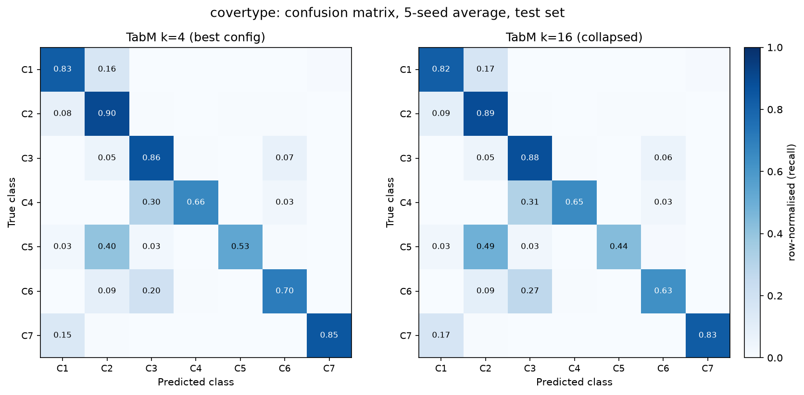
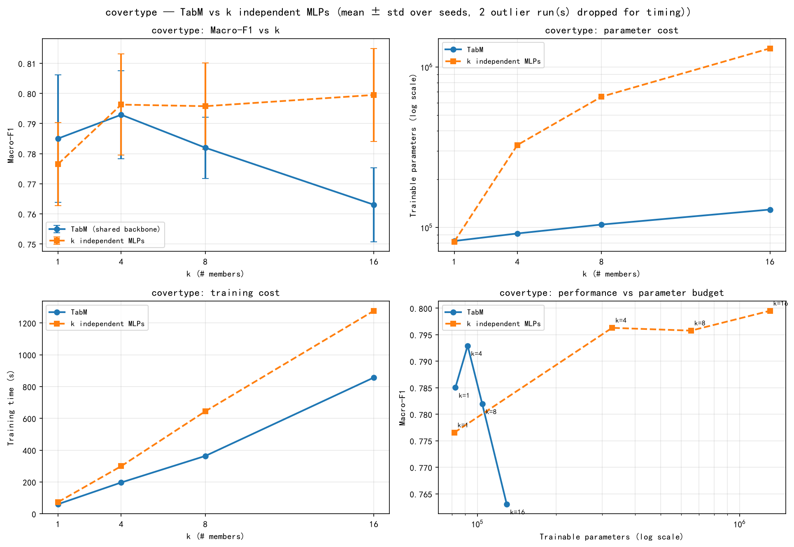

# 完整实验结果与口径

[← 返回 README](../README.md) ｜ 数据来源：`results/all_result.csv`（165 行）、`results/cost/`、`results/variance/`、`results/error_analysis/`、`results/extra_metrics/`、`results/extension/`

除特别注明，数值均为 **5 个随机种子的 mean ± std**，测试集只用于最终评估。

## 0 一页结论

| 假设 | 判定 | 证据摘要 |
|---|---|---|
| **H1** TabM(k>1) 优于同预算 MLP | **部分支持** | 三个数据集上 TabM(k≥4) 均高于 MLP（adult +0.4~0.6 pp、california +0.3~0.8 pp、covertype +0.4~1.5 pp），但幅度与种子标准差（±0.4~2.2 pp）同量级；只有 adult 的 k=16 vs k=1 达到配对 t 检验显著（p=0.011），covertype 上 k=16 反而显著变差（p=0.011） |
| **H2** 收益来自成员多样性而非单纯加参数 | **证据不足（偏否）** | 参数只涨 1.30~1.57 倍、训练时间涨 8~14 倍；`member_corr` 始终 0.86~0.99；逐样本概率方差 TabM 只有独立 MLP 的 40%（adult）/ 76%（covertype）。但独立 MLP 对照说明多样性机制本身有效，故修正表述为「机制成立、TabM 未充分利用」 |
| **H3** 大 k 训练后裁剪优于直接训练小 k | **不支持** | 6 组对照中 5 组劣于原生同 k；唯一正增益 adult crop=4 仅 +0.24 pp，落在种子噪声内；covertype 裁剪损失 2.0~3.0 pp，同时 ECE 从 0.015 恶化到 0.031~0.035、AUC 从 0.9822 掉到 0.9784~0.9792 |
| **拓展** 与 k 个独立 MLP 的严格成本对照 | **参数高效成立、泛化优势不成立** | adult / california 上两者打平（Δ≤0.005）而 TabM 只用 1/4~1/13 参数、1/1.5~1/2.9 时间；covertype 上 k=16 的独立 MLP 反超 3.6 pp |

**总体判断**：在本课程预算下（CPU、covertype 下采样 5 万行、统一 100 epoch），TabM 相对 MLP 的优势存在但很小，远不足以抵消 8~14 倍的训练成本，且整体落后于 XGBoost / HistGBM（adult −2.0 pp、california −0.024 R²），仅在 covertype 上小幅领先树模型。

## 1 主结果

### 1.1 Adult（二分类，主指标 Macro-F1）

| 模型 | Macro-F1 | ROC-AUC | LogLoss | ECE | 参数量 | 训练时间 |
|---|---|---|---|---|---|---|
| XGBoost | 0.8133 ± 0.0032 | 0.9267 ± 0.0017 | 0.2809 | 0.0132 | — | 0.4 s |
| HistGBM | **0.8140** ± 0.0038 | **0.9277** ± 0.0018 | **0.2783** | **0.0061** | — | 0.3 s |
| MLP | 0.7861 ± 0.0069 | 0.9099 ± 0.0032 | 0.3142 | 0.0091 | 102,488 | 12.1 s |
| TabM k=1 | 0.7888 ± 0.0042 | 0.9129 ± 0.0026 | 0.3088 | 0.0081 | 94,932 | 11.3 s |
| TabM k=4 | 0.7920 ± 0.0064 | 0.9141 ± 0.0019 | 0.3064 | 0.0070 | 100,636 | 29.1 s |
| TabM k=8 | 0.7943 ± 0.0039 | 0.9148 ± 0.0017 | 0.3055 | 0.0081 | 108,242 | 54.6 s |
| TabM k=16 | 0.7929 ± 0.0047 | 0.9149 ± 0.0017 | 0.3050 | 0.0082 | 123,453 | 121.5 s |

### 1.2 California Housing（回归，主指标 R²）

| 模型 | R² | RMSE | 参数量 | 训练时间 |
|---|---|---|---|---|
| XGBoost | 0.8293 ± 0.0036 | — | — | 0.3 s |
| HistGBM | **0.8329** ± 0.0064 | — | — | 0.2 s |
| MLP | 0.8008 ± 0.0062 | — | 68,353 | 19.3 s |
| TabM k=1 | 0.8059 ± 0.0076 | 0.5055 | 69,129 | 23.2 s |
| TabM k=4 | **0.8088** ± 0.0060 | **0.5018** | 73,764 | 60.4 s |
| TabM k=8 | 0.8050 ± 0.0104 | 0.5067 | 79,944 | 96.2 s |
| TabM k=16 | 0.8041 ± 0.0054 | 0.5079 | 92,304 | 187.3 s |

### 1.3 Covertype（7 类，下采样 5 万行，主指标 Macro-F1）

| 模型 | Macro-F1 | ROC-AUC (macro-OvR) | LogLoss | ECE | 参数量 | 训练时间 |
|---|---|---|---|---|---|---|
| XGBoost | 0.7597 ± 0.0101 | 0.9767 ± 0.0013 | 0.4052 | 0.0198 | — | 2.1 s |
| HistGBM | 0.7296 ± 0.0424 | 0.9594 ± 0.0217 | 0.4800 | 0.0275 | — | 2.0 s |
| MLP | 0.7784 ± 0.0225 | 0.9799 ± 0.0011 | 0.3813 | 0.0187 | 81,671 | 53.7 s |
| TabM k=1 | 0.7850 ± 0.0211 | 0.9804 ± 0.0031 | 0.3765 | 0.0188 | 82,493 | 60.7 s |
| TabM k=4 | **0.7929** ± 0.0146 | **0.9822** ± 0.0015 | **0.3484** | **0.0151** | 91,892 | 196.9 s |
| TabM k=8 | 0.7820 ± 0.0102 | 0.9816 ± 0.0007 | 0.3606 | 0.0264 | 104,424 | 363.9 s |
| TabM k=16 | 0.7631 ± 0.0123 | 0.9794 ± 0.0012 | 0.3825 | 0.0362 | 129,488 | 856.6 s |

> ⚠️ **covertype 训练时间口径**：seed=4 的一整轮与其它任务同机并行，k=8 / k=16 被拖到 754 s / 1413 s；seed=3 的 k=16 被拖到 1394 s。上表 k=16 的 856.6 s 是被这两个异常值抬高的**均值**，不能直接引用。稳健口径用**中位数**：k=1 = 45.3 s、k=4 = 151.3 s、k=8 = 266.1 s、k=16 = 510.7 s。参数量不受运行环境影响。
>
> **AUC / LogLoss 口径**：这两列由 `scripts/eval_extra_auc.py --fill` 单独补算——k=16 直接加载 `ckpt/` 推理，其余配置按同一划分与同一预算**重训**后取测试集概率，结果落在 `results/extra_metrics/covertype_auc.csv` 并回填本表。因此同一行的 AUC 与 Macro-F1 不是同一次训练的产物（重训波动实测 ≤1 pp）；跨行比较 AUC 趋势安全，但不要解读同一行内两者的关系。HistGBM 的 AUC 均值被 seed=4 的一次崩溃（0.9234，对应 Macro-F1 0.662）拉低，其余 4 个种子在 0.9567~0.9767。

## 2 成本放大倍数（相对同数据集 k=1）

| 数据集 | k=4 | k=8 | k=16 |
|---|---|---|---|
| adult | 参数 ×1.06 / 时间 ×2.56 | ×1.14 / ×4.81 | ×1.30 / ×10.72 |
| california | ×1.07 / ×2.60 | ×1.16 / ×4.14 | ×1.34 / ×8.06 |
| covertype（均值口径，受污染） | ×1.11 / ×3.25 | ×1.27 / ×6.00 | ×1.57 / ×14.12 |
| **covertype（中位数口径，推荐）** | ×1.11 / **×3.34** | ×1.27 / **×5.87** | ×1.57 / **×11.27** |

**关键观察**：参数近乎线性增长且 1.3~1.6 倍封顶（这是 TabM 的设计目标），但训练时间随 k 近似线性膨胀（8~14 倍）——「参数高效」不等于「计算高效」。

## 3 推理延迟与峰值内存

产物：`results/cost/infer_cost.csv`（105 行 = 3 数据集 × 5 种子 × 7 配置）、`results/cost/train_peak_seed0.csv`（21 行，seed=0）。

**推理延迟**（ms/样本，5 个种子取中位）

| 配置 | adult | california | covertype |
|---|---|---|---|
| XGBoost | 0.0006 | 0.0008 | 0.0041 |
| HistGBM | 0.0016 | 0.0017 | 0.0091 |
| MLP | 0.0030 | 0.0015 | 0.0017 |
| TabM k=1 | 0.0048 | 0.0024 | 0.0031 |
| TabM k=4 | 0.0081 | 0.0050 | 0.0061 |
| TabM k=8 | 0.0131 | 0.0081 | 0.0113 |
| TabM k=16 | 0.0222 | 0.0151 | 0.0200 |
| **k=16 / k=1** | **4.6×** | **6.3×** | **6.5×** |

**训练峰值内存**（RSS，MB；每配置独立子进程，seed=0）

| 配置 | adult | california | covertype | 相对同数据集 MLP |
|---|---|---|---|---|
| XGBoost | 385 | 357 | 389 | — |
| HistGBM | 389 | 353 | 409 | — |
| MLP | 460 | 436 | 455 | 基准 |
| TabM k=1 | 464 | 438 | 455 | +4 / +2 / 0 |
| TabM k=4 | 474 | 450 | 471 | +14 / +14 / +16 |
| TabM k=8 | 487 | 464 | 481 | +27 / +28 / +26 |
| TabM k=16 | 503 | 488 | 510 | **+43 / +52 / +55** |

TabM 的理论权重内存（`params × 4 B`）在 k=1→16 只从 0.26~0.36 MB 涨到 0.35~0.49 MB。

> **三条口径**
> 1. 推理延迟 = 仅模型前向 + softmax/平均，batch=256，**不含 DataLoader**，5 次取中位；这是「模型前向延迟」，不是端到端吞吐。k=16 用 `ckpt/` 真实权重，其余用同结构未训练模型（权重数值不影响计时）。
> 2. 峰值 RSS = 每配置**单独启子进程**，`psutil` 每 50 ms 采样。RSS 在同进程内不会归还 OS，会跨配置单调累积（旧版同进程测出 385→581 MB 的单调爬升即为此污染，已废弃重测）。表内绝对值含进程基线（import torch + 加载数据 ≈ 350~410 MB），模型自身开销请看差值列。
> 3. `infer_rss_delta_mb` 实测 ≈ 0：推理所需内存在 warmup 阶段已向分配器申请，正式计时阶段全部复用。

**三条结论**

1. 推理延迟随 k 近似线性（4.6~6.5 倍），但比训练时间的膨胀（8~14 倍）温和得多——k 增大主要惩罚训练。
2. 内存几乎不随 k 涨：权重只涨 0.09~0.17 MB，实测峰值差 +39~55 MB 主要来自 k 个成员各自的前向激活与分配器缓存，不是权重。
3. TabM 的成本瓶颈是**计算（训练时间）**，不是内存。

## 4 H1：TabM(k>1) 是否优于同预算 MLP

| 数据集 | MLP | TabM 最好 k | 提升 | 配对 t 检验（k=16 vs k=1） |
|---|---|---|---|---|
| adult | 0.7861 | 0.7943 (k=8) | +0.82 pp | t=4.52, **p=0.011** |
| california | 0.8008 | 0.8088 (k=4) | +0.80 pp | t=−0.84, p=0.448（不显著） |
| covertype | 0.7784 | 0.7929 (k=4) | +1.45 pp | t=−4.49, **p=0.011（反向显著）** |

→ 方向成立，但幅度与种子噪声同量级；covertype 上 k 增大到 16 反而显著变差。

## 5 H2：成员多样性证据

**成员相关性 `member_corr`**（成员间预测类别（回归为输出）相关系数的均值，越大越趋同）

| 数据集 | k=4 | k=8 | k=16 |
|---|---|---|---|
| adult | 0.9458 | 0.9308 | 0.9283 |
| california | 0.9936 | 0.9938 | 0.9924 |
| covertype | 0.8767 | 0.8659 | 0.8647 |

**逐样本概率方差等补充指标**（`results/variance/member_variance.csv`，30 行）

| 数据集 | 来源 | 逐样本概率方差 ↓ | argmax 分歧率 ↓ | 成员相关性 ↓ |
|---|---|---|---|---|
| adult | TabM k=16 | 0.00068 | 0.0717 | 0.9283 |
| adult | 独立 16×MLP | 0.00170 | 0.1196 | 0.8809 |
| california | TabM k=16 | 0.00768 | —（回归无类别） | 0.9924 |
| california | 独立 16×MLP | 0.00887 | — | 0.9915 |
| covertype | TabM k=16 | 0.00219 | 0.2743 | 0.8647 |
| covertype | 独立 16×MLP | 0.00287 | 0.2667 | 0.8730 |

> 口径：`mean_prob_var` = 每个测试样本、每个类别上跨 16 个成员的概率方差，再对样本与类别取平均；`frac_disagree` = 16 个成员 argmax 不完全一致的样本占比（回归无定义）。TabM 侧取 `ckpt/…_k16.pt` 的成员输出，独立侧取 `results/extension/member_probs_*.npz`；该脚本复算的 `member_corr` 与主表完全对齐（0.92826 / 0.99244 / 0.86471）。

→ adult：TabM 的方差只有独立 MLP 的 40%，分歧率也只有一半，但性能打平——多样性没换来收益，TabM 用 1/13 参数拿到同一结果。
→ covertype：TabM 方差少 24%，而独立 MLP 在 k=16 反超 3.6 pp——多样性是该任务的关键变量，共享主干把成员压成了同一个模型。
→ 注意 covertype 的 `frac_disagree` 与方差方向相反（0.2743 > 0.2667）：类别不平衡下多数类主导 argmax，单看一致率会失真，故以**方差为主证据、相关性为辅、分歧率仅参考**。
→ 综合表述：H2 不是「多样性无用」，而是「机制成立、TabM 在小预算下没有充分利用」。

## 6 H3：大 k 训练后裁剪

| 数据集 | crop | 原生 k=N | 随机裁剪 | val 择优裁剪 | 择优 − 原生 |
|---|---|---|---|---|---|
| adult | 4 | 0.7920 | 0.7925 | 0.7944 | **+0.0024** |
| adult | 8 | 0.7943 | 0.7937 | 0.7939 | −0.0004 |
| california | 4 | 0.8088 | 0.8028 | 0.8041 | −0.0047 |
| california | 8 | 0.8050 | 0.8034 | 0.8041 | −0.0009 |
| covertype | 4 | 0.7929 | 0.7538 | 0.7628 | **−0.0301** |
| covertype | 8 | 0.7820 | 0.7610 | 0.7622 | **−0.0197** |

→ H3 基本被否定：6 组对照 5 组劣于原生，唯一正增益（+0.24 pp）落在 ±0.6 pp 的种子区间内。
→ 附带发现：裁剪同时损害**校准**（covertype ECE 0.015 → 0.031~0.035）与**区分度**（macro-OvR AUC 0.9822/0.9816 → 0.9784~0.9792，四档都没回到原生水平；adult 上则基本持平 0.9145~0.9150）。
→ 说明裁剪损伤是任务相关的：成员本就高度相关的简单任务上裁剪无害，必须靠成员分化覆盖少数类的难任务上，砍成员等于砍掉仅有的多样性来源。

## 7 错误与失败分析

做法：k=4（原生最优档）当场重训 5 种子，k=16 加载 ckpt，两者共用同一划分与测试集；再做混淆矩阵、按类 P/R/F1、高置信度错分样本清单。

### 7.1 covertype：劣化集中在少数类

| 类 | k=4 召回 | k=16 召回 | Δ | 主要被误判为 |
|---|---|---|---|---|
| C1 | 0.828 | 0.822 | −0.006 | C2 |
| C2 | 0.901 | 0.889 | −0.012 | C1 |
| C3 | 0.865 | 0.882 | **+0.017** | C6 |
| C4 | 0.664 | 0.651 | −0.013 | C3 |
| C5 | 0.534 | 0.436 | **−0.098** | C2（**49%** 被判成 C2） |
| C6 | 0.704 | 0.630 | **−0.074** | C3（27% 被判成 C3） |
| C7 | 0.849 | 0.829 | −0.020 | C1 |

整体：k=4 Macro-F1 0.7863 ± 0.0183、accuracy 0.8573；k=16 Macro-F1 0.7631 ± 0.0123、accuracy 0.8459。

> 准确率只掉 1.1 pp，Macro-F1 却掉 2.3 pp（2.0 倍）→ k=16 的退化不是整体能力下降，而是**判别边界向多数类 C2 收缩**：C5 判成 C2 的比例从 40% 升到 49%，判给自己的比例从 53% 降到 44%。这与「k 越大成员相关性仍 0.86 以上」互为佐证。

### 7.2 adult：错误形态是少数类漏检，不是成员塌缩

| 指标 | 5 seed 平均 |
|---|---|
| 准确率 | 0.8587 |
| 正类（>50K）漏检率 `FN/正类` | **0.3836** |
| 负类（≤50K）误报率 `FP/负类` | 0.0651 |

→ 正类漏检率是误报率的 5.9 倍。adult 的问题集中在类别不平衡下的阈值与校准，与 covertype 的机制不同，不能混为一谈。

> 口径提醒：本节 k=4 是当场重训（主实验只存 k=16 权重），实测 0.7863 与主表 0.7929 差 0.7 pp，属同配置重训的随机波动，故只做本节内部 k4 vs k16 对比，不与主表跨口径混用。

### 7.3 产物清单

| 文件 | 内容 |
|---|---|
| `results/error_analysis/summary.txt` | 文字版结论 |
| `results/error_analysis/covertype_per_class.csv` | 按类 precision / recall / F1（k4 vs k16） |
| `results/error_analysis/covertype_confusion_k4.csv` / `_k16.csv` | 5 seed 平均混淆矩阵（行归一化） |
| `results/error_analysis/covertype_worst_errors.csv` | k=16 的 100 条高置信度错分样本（含 `p_true_class`） |
| `results/error_analysis/adult_k16_errors.csv` | adult 每 seed 的 TP/TN/FP/FN |
| `plots/error_analysis/covertype_confusion_k4_vs_k16.png` | 左右并排混淆矩阵 |

## 8 拓展：与 k 个独立 MLP 的严格成本对照

设计与口径见 [method.md §7](method.md)。

**Adult（Macro-F1）**

| k | TabM | 独立 k×MLP | Δ指标 | 参数比 | 时间比 |
|---|---|---|---|---|---|
| 1 | 0.7888 ± 0.0042 | 0.7876 ± 0.0067 | −0.0012 | 1.08× | 1.74× |
| 4 | 0.7920 ± 0.0064 | 0.7909 ± 0.0062 | −0.0010 | 4.07× | 2.68× |
| 8 | **0.7943** ± 0.0039 | 0.7897 ± 0.0051 | −0.0046 | 7.57× | 2.86× |
| 16 | 0.7929 ± 0.0047 | 0.7904 ± 0.0047 | −0.0025 | 13.28× | 2.60× |

**California（R²）**

| k | TabM | 独立 k×MLP | Δ指标 | 参数比 | 时间比 |
|---|---|---|---|---|---|
| 1 | 0.8059 ± 0.0076 | 0.8009 ± 0.0064 | −0.0050 | 0.99× | 1.47× |
| 4 | **0.8088** ± 0.0060 | 0.8061 ± 0.0092 | −0.0026 | 3.71× | 2.26× |
| 8 | 0.8050 ± 0.0104 | 0.8068 ± 0.0079 | +0.0018 | 6.84× | 2.77× |
| 16 | 0.8041 ± 0.0054 | 0.8062 ± 0.0073 | +0.0022 | 11.85× | 2.76× |

**Covertype（Macro-F1）**

| k | TabM | 独立 k×MLP | Δ指标 | 参数比 | 时间比 |
|---|---|---|---|---|---|
| 1 | **0.7850** ± 0.0211 | 0.7765 ± 0.0138 | −0.0085 | 0.99× | 1.21× |
| 4 | 0.7929 ± 0.0146 | 0.7963 ± 0.0168 | +0.0034 | 3.56× | 1.52× |
| 8 | 0.7820 ± 0.0102 | 0.7958 ± 0.0144 | +0.0138 | 6.26× | 1.77× |
| 16 | 0.7631 ± 0.0123 | **0.7995** ± 0.0155 | **+0.0364** | 10.09× | 1.49× |

**三点结论**

1. **参数高效是真的**：adult / california 上两者性能打平（Δ≤0.005，落在种子噪声内），TabM 只用 1/4~1/13 参数、1/1.5~1/2.9 训练时间。
2. **「计算高效」只是相对的**：TabM 自身训练时间仍随 k 线性膨胀（adult ×10.7、covertype ×14.1），只是比 k 个独立模型串行训练省 1.5~2.9 倍。
3. **covertype 出现反向结论**：16 个独立 MLP 的集成增益随 k 单调上升（k=4 +0.0198、k=8 +0.0192、k=16 +0.0230），而 TabM 从 k=8 起倒挂、k=16 比自己的 k=1 还低 2.2 pp → TabM 的共享主干在「多类 + 大 k + 受限预算」下削弱了成员分化。

## 9 课程设置与论文设置并排

| 维度 | 论文（TabM, ICLR 2025） | 本项目（课程规模） |
|---|---|---|
| 数据集数量 | 46 个表格数据集 | 3 个（Adult / Covertype / California） |
| Covertype 规模 | 全量 581,012 行 | 下采样 50,000 行（CPU 限制） |
| 超参搜索 | 每数据集独立调参（数百次试验） | 全数据集共用一套固定超参，无搜索 |
| 训练预算 | 按数据集规模自适应，通常数百 epoch | 固定 `max_epoch=100`、`patience=10` |
| 硬件 | GPU | 纯 CPU（torch 2.15.0+cpu） |
| 种子数 | 15 个 | 5 个 |
| 评估 | 多次划分 / 交叉验证 | 单次固定划分 × 5 种子 |
| California 数据 | sklearn 官方包 | sklearn 缓存或 OpenML 44977 重建（同口径） |

→ 绝对数值不可与论文表格直接比较，只能比较「相同预算下的相对趋势」。
